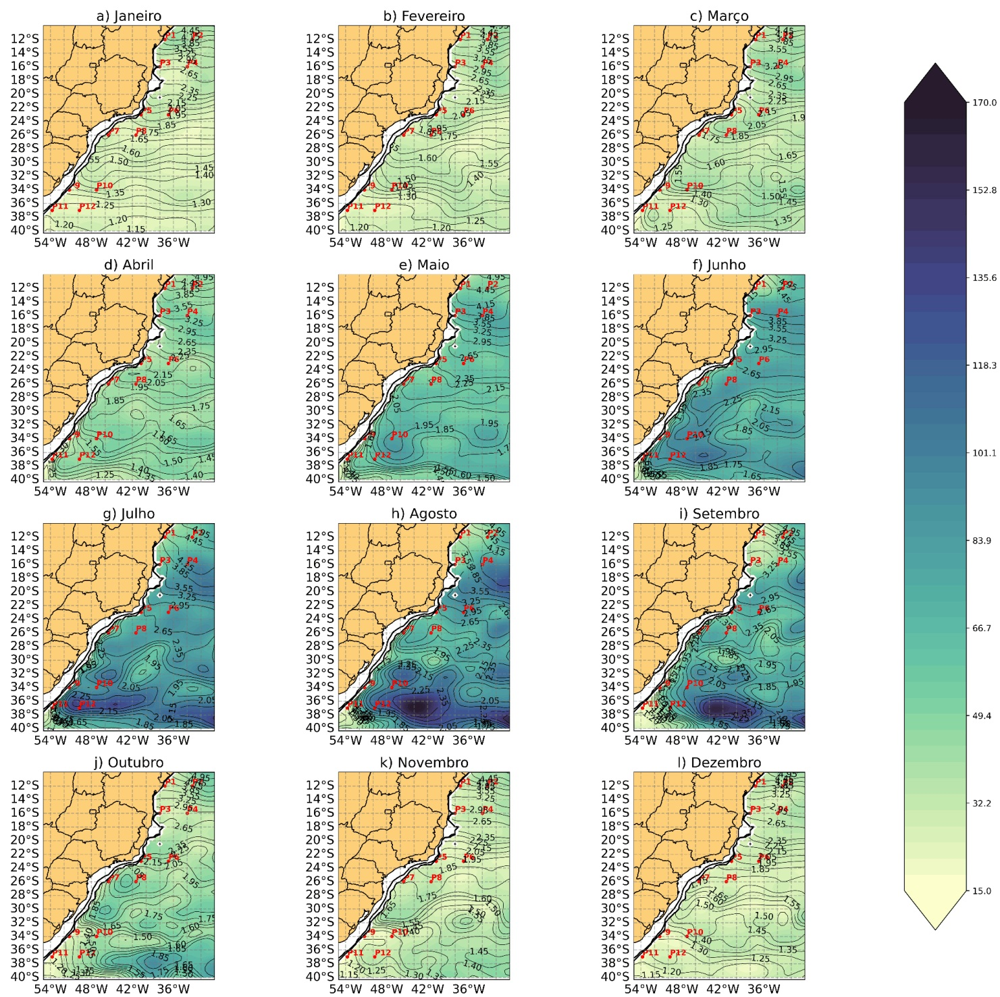

**Every step of my career in one image**
A visual timeline of my journey so far, highlighting the key milestones and experiences that have shaped my career.

**Research Assistant -** *National Institute for Space Research - INPE (Brazil)*

**MSc - Physical Oceanography -** *University of São Paulo*

**BSc - Oceanography -** *Rio de Janeiro State University*

It is a simple project that I developed over the last six months of my undergraduate degree, back in 2023,
in order to meet the requirements to earn my BSc degree. My goal was to characterize the deformation
radius of the mixed layer in order to understand the length of the motions restricted within the mixed layer;
I also characterized the seasonality of the mixed layer depth along the Brazilian margin. In the image, colors 
represent the mixed layer depth, and black isolines represent the mixed layer deformation radius.

    

    &#8593;

**Internship - Meteorology department -** *Rio de Janeiro Federal University*

During my BSc degree, I had the opportunity to complement my studies with an internship with a meteorology group.
This experience, which I carried out over 2 years, was a great opportunity to engage for the first time with 
academia officially while I was earning a scholarship from the same group to compare different reanalyses 
regarding wave and wind parameters. My role was to compare different reanalysis products against offshore
buoy data and discover which one was better for the region of interest.

    

